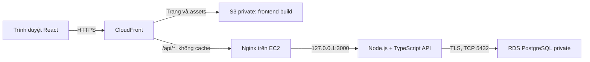

# Đề xuất AWS 3 lớp và Task 1 mới — EstateFlow

Ngày: 13/10/2026. Trạng thái: **đã được thay thế** bởi [phương án frontend tĩnh S3 + CloudFront](aws-static-deployment.md), theo lựa chọn giữ kiến trúc ứng dụng hiện tại của người dùng. Các thay đổi backend/database dưới đây không thuộc phạm vi đang thực hiện. Chưa triển khai hoặc thay đổi code ứng dụng.

## 1. Mục tiêu và hiện trạng

Xây dựng bài thực tập DevOps có React + TypeScript + Zustand, backend API và PostgreSQL; cùng một codebase chạy local, trên VPS và trên AWS. Tài khoản AWS đang là **Free account plan**, có 100 USD credit; chưa xác minh các giới hạn cụ thể trong Console.

Ứng dụng hiện có CRUD tòa nhà, phòng, booking; validation, chặn xóa dữ liệu có liên kết và giữ lịch sử booking đã hủy. Tuy nhiên, `src/store/estateStore.ts` lưu dữ liệu bằng Zustand persist/localStorage. Chưa có backend, database, đăng nhập hoặc cấu hình triển khai. Git chưa có commit; các file ứng dụng hiện tại đều chưa được theo dõi.

Giữ giao diện, kiểu dữ liệu và quy tắc nghiệp vụ hiện có. Chuyển nguồn dữ liệu chính sang PostgreSQL; Zustand quản lý dữ liệu đang hiển thị và trạng thái gọi API.

## 2. Lựa chọn kiến trúc

| Phương án | Điểm phù hợp | Đánh đổi |
| --- | --- | --- |
| **S3 + CloudFront / EC2 / RDS PostgreSQL** | Ba lớp có tài nguyên riêng; học CDN, Linux, API, VPC, Security Group, database; dùng cùng backend với VPS | EC2 và RDS tiêu credit ngay cả khi không có người truy cập; phải cấu hình origin API |
| EC2 chạy Nginx + API + PostgreSQL | Ít dịch vụ, tiết kiệm hơn, dễ giống VPS | Ba lớp logic cùng máy; vận hành và lỗi máy ảnh hưởng cả ứng dụng lẫn database |
| S3 + CloudFront / API Gateway + Lambda / DynamoDB | Có thể rẻ hơn khi ít request | Backend và mô hình dữ liệu khác nhiều với VPS; quan hệ và chống trùng booking cần thiết kế khác |

**Đề xuất phương án đầu tiên** vì phù hợp nội dung trainer và yêu cầu frontend/backend/database riêng. Phương án một EC2 là lựa chọn dự phòng nếu RDS bị chặn hoặc cần giảm chi phí; không trình bày nó là ba tầng hạ tầng độc lập.

Frontend gọi đường dẫn tương đối `/api/...` trên cùng hostname CloudFront. Không cấu hình trình duyệt gọi trực tiếp IP EC2 hoặc RDS.

### Frontend

- React, TypeScript, Vite, React Router, Zustand như hiện tại.
- S3 dùng REST origin và Origin Access Control (OAC); bật Block Public Access. Bucket policy chỉ cho distribution đã chỉ định đọc object.
- CloudFront phục vụ HTTPS bằng hostname mặc định, không bắt buộc mua domain.
- Default behavior phục vụ S3; `/api` và `/api/*` đi EC2, cho phép các HTTP method cần thiết, dùng cache policy `CachingDisabled` và chuyển cookie, query, header cần cho phiên đăng nhập/CSRF.
- Chỉ behavior frontend có CloudFront Function rewrite các route SPA về `/index.html`; assets giữ nguyên đường dẫn. Không dùng global 403/404 -> HTML vì sẽ che lỗi API.
- Assets có hash được cache lâu; `index.html` cache ngắn hoặc revalidate.

### Backend

- Một EC2 `t3.micro`, Linux, EBS gp3 8–10 GiB; dùng CPU credit mode Standard để tránh phí surplus CPU của Unlimited.
- Node.js 24 LTS, TypeScript, Express, driver `pg`. SQL migrations; không cần ORM cho ba bảng nghiệp vụ.
- Nginx reverse proxy; API chỉ bind `127.0.0.1:3000`. systemd chạy API bằng user riêng và tự khởi động lại sau reboot.
- Build trên local/CI, upload artifact đã kiểm tra; tránh build thường xuyên trên máy 1 GiB RAM.
- Có endpoint liveness, readiness kiểm tra database và release SHA để demo/debug.

### Database

- RDS PostgreSQL Single-AZ, `db.t4g.micro` nếu Console cho phép, storage gp3 20 GiB.
- Dùng engine đang trong standard support, không dùng Aurora cho bài này.
- Publicly accessible = No. DB subnet group có hai private subnet ở hai AZ; DB instance vẫn là Single-AZ.
- EC2 và DB primary cùng AZ khi có thể để giảm độ trễ/phí liên AZ.
- Bật mã hóa storage và backup tự động, retention ngắn phù hợp bài lab. Đặt trần storage autoscaling nếu sử dụng.
- Application DB user chỉ có quyền dữ liệu cần thiết; migration dùng credential riêng. Kết nối TLS với CA của RDS và xác minh certificate.

## 3. Mạng và bảo mật

VPC có một public subnet cho EC2, hai private subnet cho RDS và Internet Gateway. Private route table không có đường Internet Gateway. Không tạo NAT Gateway hoặc ALB trong cấu hình cơ bản này.

| Đích | Port | Nguồn được phép |
| --- | --- | --- |
| SSH vào EC2 | 22 | IP người quản trị `/32`; không mở toàn Internet |
| Nginx origin | 443 khi có domain; 80 cho demo HTTP origin | CloudFront origin-facing managed prefix list |
| Node API | 3000 | Loopback trên EC2; không mở trong Security Group |
| RDS | 5432 | Security Group của EC2 |

Ngoài Security Group, Nginx kiểm tra secret origin header do CloudFront thêm để giới hạn distribution được phép dùng origin. Secret này chỉ đặt ở CloudFront/Nginx, không đưa vào frontend bundle. Header đó không thay thế đăng nhập quản trị.

**Khi có domain:** hostname website trỏ CloudFront; certificate CloudFront ở `us-east-1`. Hostname origin riêng trỏ EC2, dùng certificate hợp lệ trên Nginx; origin protocol = HTTPS Only. Có thể dùng DNS nhà cung cấp domain hiện có, không bắt buộc Route 53.

**Khi chưa có domain:** website vẫn có HTTPS ở hostname CloudFront. Custom origin EC2 có thể dùng HTTP cho bài demo dữ liệu giả, nhưng chặng CloudFront → EC2 không mã hóa; không mô tả đây là HTTPS toàn tuyến hoặc dùng dữ liệu khách hàng thật. Prefix list và origin header không cung cấp mã hóa. Muốn loại bỏ giới hạn này, cần domain/certificate cho origin hoặc thiết kế CloudFront VPC origin riêng, kèm phương án quản trị/deploy máy private.

AWS hiện hỗ trợ VPC origins tới EC2 private, nhưng đây không phải lựa chọn mặc định vì phải xử lý cả đường SSH/deploy và outbound cho máy private; không chỉ chuyển subnet rồi bỏ qua vận hành.

## 4. Ngân sách Free account plan

Đây là **ước lượng lập kế hoạch**, không phải báo giá hoặc kết quả kiểm tra tài khoản. Giả sử một môi trường nhỏ, khoảng 730 giờ/tháng, ít request và ít dữ liệu. Ưu tiên kiểm tra `us-east-1` cho bài lab; nếu chọn Singapore để gần Việt Nam, phải tính lại theo region.

| Hạng mục | Dự trù USD/tháng |
| --- | ---: |
| EC2 micro | 8–12 |
| EBS EC2 | 1–2 |
| RDS PostgreSQL micro | 12–20 |
| RDS storage | 2–4 |
| Một public IPv4/Elastic IP | 3.65 |
| S3, CloudFront, request/data transfer nhỏ | 0–3 |
| Log/backup phát sinh | 0–2 |
| **Tổng dự trù** | **Khoảng 27–47** |

Giữ ít nhất 15 USD dự phòng; với 85 USD dùng cho vận hành liên tục, dự trù khoảng **1.8–3.1 tháng**. Credit không có nghĩa tài nguyên miễn phí hoặc đủ chạy sáu tháng. Thời hạn thực tế còn phụ thuộc ngày tạo tài khoản, credit còn lại, region và lưu lượng.

- Xác minh dịch vụ, instance class, region, quota và lựa chọn CloudFront trong chính Console trước khi tạo tài nguyên. Không tự chuyển sang Paid plan khi gặp giới hạn.
- AWS công bố EC2, S3, CloudFront và RDS dùng được trên Free account plan, nhưng quyền dùng dịch vụ không bảo đảm mọi feature/class đều khả dụng trong tài khoản.
- Thiết lập theo dõi credit, cost/usage và cảnh báo ngân sách nếu tính năng được cấp quyền. Cảnh báo ngân sách không phải cơ chế tự ngắt chi phí.
- Sau buổi học có thể stop EC2/RDS; vẫn có phí storage, snapshot và Elastic IP giữ lại. RDS tự khởi động sau bảy ngày stop liên tiếp.
- Khi kết thúc bài, xuất backup ra ngoài AWS trước khi xóa tài nguyên không cần thiết. Free plan đóng khi hết credit hoặc hết sáu tháng; không dựa vào tài khoản đó để giữ dữ liệu lâu dài.
- Domain, VPS, Git hosting/CI ngoài AWS không nằm trong bảng dự trù.

## 5. Task 1 thay thế — Ứng dụng ba lớp

### 5.1. Công nghệ và phân chia trách nhiệm

- Frontend: React + TypeScript + Zustand + Vite + React Router.
- Backend: Node.js + TypeScript + Express + PostgreSQL driver.
- Database: PostgreSQL, cùng schema trên local, VPS và RDS.
- Zustand giữ cache trong bộ nhớ, trạng thái loading/error/saving và gọi API. PostgreSQL là nguồn dữ liệu chính.
- Không lưu thông tin khách hàng, credential hoặc session token trong localStorage. localStorage chỉ có thể giữ tùy chọn giao diện.
- Một tài khoản quản trị được provision bằng cấu hình server; đăng nhập/đăng xuất, mật khẩu hash và phiên có hạn. Không thêm đăng ký, nhiều vai trò hoặc multi-tenant.
- Cookie phiên HttpOnly, Secure ở production, SameSite; session lưu PostgreSQL để tồn tại qua restart và hủy được khi logout. Request thay đổi dữ liệu có bảo vệ CSRF; login có giới hạn số lần thử.
- API bảo vệ cả đọc thông tin khách hàng lẫn CRUD; không chỉ ẩn nút trên frontend.

### 5.2. Quản lý tòa nhà

- Danh sách, thêm, sửa, xóa, tìm theo tên.
- Giữ các trường hiện có: id, tên, địa chỉ, tỉnh/thành phố, số tầng, trạng thái `active | maintenance`.
- Số tầng nguyên dương; chuỗi bắt buộc được trim, giới hạn độ dài.
- Không xóa tòa nhà có phòng; không giảm số tầng xuống dưới tầng của phòng đang có.

### 5.3. Quản lý phòng

- Danh sách, thêm, sửa, xóa; liên kết tòa nhà; lọc theo tòa nhà và trạng thái.
- Giữ id, buildingId, số phòng, tầng, diện tích, giá thuê, trạng thái `available | maintenance`.
- Unique số phòng trong cùng tòa nhà, không phân biệt hoa/thường và khoảng trắng ngoài.
- Tầng từ 1 đến số tầng tòa nhà; diện tích và giá thuê hữu hạn, lớn hơn 0.
- Không xóa phòng có booking, kể cả đã hủy, để giữ lịch sử.
- Không thêm trạng thái `occupied` ghi cố định vào DB: lịch sử sử dụng phòng được xác định từ booking theo ngày, như mô hình hiện tại.

### 5.4. Quản lý booking

- Danh sách, thêm, sửa, hủy; giữ thông tin khách, điện thoại, phòng, ngày nhận/trả, trạng thái `confirmed | cancelled`.
- Ngày dùng chuỗi `YYYY-MM-DD` ở API và kiểu DATE trong DB; không chuyển ngày thuần thành timestamp phụ thuộc múi giờ.
- Ngày trả phải sau ngày nhận; khoảng đặt phòng là `[checkIn, checkOut)`. Ngày trả của booking trước được trùng ngày nhận của booking sau.
- Chỉ booking confirmed chiếm lịch. Booking đã hủy giữ lịch sử, không chỉnh sửa hoặc kích hoạt lại.
- Không tạo hoặc chuyển booking vào phòng bảo trì. Giữ hành vi hiện tại cho booking đã ở phòng đó khi phòng chuyển sang bảo trì.
- Chống trùng ở database cho cả INSERT và UPDATE, gồm hai request đồng thời; validation frontend chỉ phục vụ trải nghiệm.

### 5.5. Schema và toàn vẹn dữ liệu

Ba bảng nghiệp vụ `buildings`, `rooms`, `bookings` tương ứng các TypeScript type hiện có; thêm bảng session và bảng lịch sử migration phục vụ vận hành.

- ID do server sinh; không nhận id/status tùy ý từ payload tạo booking.
- Foreign key `rooms.building_id -> buildings.id`, `bookings.room_id -> rooms.id`, `ON DELETE RESTRICT`.
- CHECK cho enum, số dương, floor nguyên dương và `check_out > check_in`.
- Unique index `(building_id, lower(trim(room_number)))`.
- Giá VND lưu NUMERIC, giới hạn miền dữ liệu và chuyển về JSON number trong phạm vi an toàn; không dùng float làm nguồn lưu tiền. DATE được serialize nguyên chuỗi, tránh parser chuyển thành Date JavaScript.
- Exclusion constraint dùng `btree_gist`, `room_id WITH =` và `daterange(check_in, check_out, '[)') WITH &&`, chỉ áp dụng `status = 'confirmed'`.
- Constraint đảm bảo concurrency của booking. Các kiểm tra liên quan nhiều bảng, như tầng phòng và bảo trì, dùng transaction/row lock thống nhất để không bị race với cập nhật tòa nhà/phòng.
- SQL parameterized, rollback transaction khi lỗi. Map constraint conflict thành HTTP 409; không trả SQL, password hoặc stack trace cho client.

### 5.6. API và giao diện

| Endpoint | Hành vi |
| --- | --- |
| `POST /api/auth/login`, `POST /api/auth/logout`, `GET /api/auth/me` | Quản lý phiên admin |
| `GET /api/buildings`, `POST /api/buildings` | Danh sách/tạo tòa nhà |
| `PATCH /api/buildings/:id`, `DELETE /api/buildings/:id` | Sửa/xóa tòa nhà |
| `GET /api/rooms`, `POST /api/rooms` | Danh sách/tạo phòng |
| `PATCH /api/rooms/:id`, `DELETE /api/rooms/:id` | Sửa/xóa phòng |
| `GET /api/bookings`, `POST /api/bookings` | Danh sách/tạo booking |
| `PATCH /api/bookings/:id` | Sửa booking hoặc chuyển status sang cancelled, không trộn hủy và sửa thông tin trong cùng request |
| `GET /api/dashboard` | Số liệu tổng hợp đầy đủ, không tính sai từ một trang danh sách |
| `GET /api/health`, `GET /api/ready` | Liveness/readiness, không lộ credential |

List endpoint có page/pageSize với giới hạn hợp lý, filter tương ứng yêu cầu và thứ tự ổn định. UI danh sách dùng phân trang đơn giản. Form chọn tòa nhà/phòng lấy đủ các trang cần thiết để không bỏ sót lựa chọn; không lấy số liệu tổng quan từ cache danh sách đã phân trang.

Response entity giữ tên camelCase/enum như frontend hiện có. Lỗi thống nhất `{ error: { code, message } }`: 400 payload sai, 401 chưa đăng nhập, 403 CSRF/quyền, 404 không tồn tại, 409 xung đột/ràng buộc, 422 validation nghiệp vụ, 503 DB tạm không sẵn sàng.

Frontend có trạng thái tải, lỗi và thử tải lại; khóa submit trong khi lưu, giữ form khi API lỗi. Chỉ đóng dialog/thông báo thành công sau khi server xác nhận. Không tự fallback về dữ liệu demo khi API lỗi. Khi request ghi timeout, không tự retry POST: báo kết quả chưa xác định và tải lại dữ liệu trước khi người dùng quyết định gửi tiếp.

### 5.7. Dữ liệu demo và dữ liệu localStorage cũ

- Seed là lệnh riêng, chỉ chạy có chủ đích; không tự seed/reset lúc server start hoặc deploy.
- Bỏ nút reset toàn bộ dữ liệu trong giao diện production để không biến thao tác local cũ thành xóa dữ liệu dùng chung.
- Không tự upload dữ liệu khách hàng trong localStorage cũ lên server và không xóa khóa cũ. Bản mới không đọc khóa đó làm nguồn dữ liệu. Nếu cần chuyển dữ liệu thật, làm bước export/import riêng sau khi xác nhận phạm vi.

### 5.8. Điều kiện nghiệm thu

1. CRUD, tìm kiếm, lọc và giữ lịch sử hoạt động qua API/database.
2. Hai trình duyệt đăng nhập cùng môi trường nhìn thấy cùng dữ liệu sau khi tải lại; xóa localStorage không xóa dữ liệu PostgreSQL.
3. Dữ liệu tồn tại sau refresh, restart API và rebuild frontend.
4. Hai POST booking trùng lịch đồng thời: một thành công, một 409; DB chỉ có một booking confirmed cho khoảng đó. UPDATE cũng không tạo overlap.
5. Booking liền ngày được chấp nhận; hủy giải phóng lịch; edit không tự xung đột với chính mình.
6. Foreign key, số phòng trùng, tầng sai, dữ liệu không đúng kiểu/enum/ngày đều bị chặn từ API, kể cả gửi trực tiếp bằng curl.
7. Chưa đăng nhập không đọc hoặc sửa dữ liệu quản lý; CSRF và login sai nhiều lần bị chặn.
8. Tắt database/API: UI báo lỗi, không báo lưu thành công, không mất nội dung form và không hiển thị demo như dữ liệu thật.
9. `typecheck`, lint, unit test, API integration test với PostgreSQL thật và Playwright qua frontend + backend đều pass.
10. Production build không chứa DB password, session secret hoặc origin secret.

## 6. Phạm vi code cần thay đổi sau khi duyệt thiết kế

- `src/types/index.ts`: contract bất đồng bộ, response/error/pagination; giữ entity hiện có.
- `src/store/estateStore.ts`: bỏ persist dữ liệu nghiệp vụ, thêm API actions và trạng thái request.
- `src/pages/*`: loading/error, await mutations, dữ liệu dashboard và danh sách phân trang.
- `src/components/{buildings,rooms,bookings}/*Form.tsx`: async save và dữ liệu lựa chọn từ server.
- `src/components/common/{FormPanel,ConfirmDialog}.tsx`: await, khóa thao tác, thông báo lỗi.
- `src/components/layout/Layout.tsx`, `src/App.tsx`: khởi tạo dữ liệu sau đăng nhập, logout; bỏ nội dung localStorage/reset demo production.
- `src/utils/validation.ts`, `src/utils/bookingOverlap.ts`, `src/data/demo.ts`: giữ logic thuần phù hợp; chuyển kiểm tra đáng tin cậy sang backend/DB, seed riêng.
- Thêm backend, SQL migrations, API client, cấu hình PostgreSQL local và env mẫu không có secret thật.
- Sửa unit/store/E2E fixtures khỏi phụ thuộc localStorage; thêm test API, database concurrency, authentication và lỗi mạng.
- `package.json`, lockfile, tsconfig, Vite proxy, Playwright config, `.gitignore`, README: chạy/build/test cả frontend/backend, local setup và cấu hình deploy.

Không làm lại thiết kế giao diện, không thêm thanh toán, tenant, upload ảnh, Kubernetes hoặc microservices.

## 7. Chuẩn bị cho Task 2–5

### VPS độc lập

Nginx phục vụ frontend build, proxy `/api/` sang cùng backend Node, PostgreSQL trên VPS với data directory/volume riêng. API/DB không mở Internet. Firewall chỉ mở SSH giới hạn IP, 80/443 theo cấu hình. SPA fallback chỉ áp dụng frontend; `/api/` giữ JSON/status từ backend. AWS và VPS dùng database, credential và session secret riêng.

### Release và rollback

- Mỗi release gắn Git SHA/tag; install bằng lockfile, chạy kiểm tra và build ở thư mục/artifact mới. Build lỗi dừng trước khi thay bản đang chạy.
- Backend deploy tới release directory riêng, health-check candidate trước khi chuyển Nginx/service sang candidate; kiểm tra lại sau switch và trả về release trước nếu thất bại. Giữ bản cũ đến khi xác minh xong.
- VPS frontend: giữ release directory và đổi symlink atomically.
- AWS frontend: upload assets hash mới trước, giữ assets cũ, cập nhật `index.html` sau cùng; lưu index/artifact theo release để restore khi rollback. Không chạy `s3 sync --delete` lên bản đang phục vụ. Invalidate index khi cần.
- Release manifest ghi cả frontend SHA, backend SHA và schema version. Khi frontend deploy thất bại sau backend, giữ API tương thích bản frontend trước hoặc rollback backend theo manifest.
- Migration tương thích ngược chạy trước switch. App rollback không tự undo migration hoặc khôi phục DB cũ; backup/snapshot phục vụ phục hồi dữ liệu là quy trình riêng. Không DROP/rename cột đang dùng trong cùng release cần rollback.
- Seed và reset DB không nằm trong deploy script; không dùng lệnh xóa volume khi cập nhật.
- CI dùng credential/role quyền tối thiểu. AWS có thể dùng OIDC cho CI nếu được phép; VPS SSH theo host key đã xác minh. Chọn cách chạy deploy đáp ứng giới hạn nguồn IP SSH, không tự mở SSH toàn Internet cho runner động.

### Demo sự cố

Tài liệu vận hành cần hướng dẫn kiểm tra DNS/HTTPS, CloudFront behaviors/cache/origin, S3 OAC 403, Security Group, Nginx config/log, systemd log, readiness/DB connection, frontend console và release SHA. Phân biệt 404 của SPA với API; 502 thường cần kiểm tra upstream process/port; không sửa firewall bằng mở mọi port.

Chỉ được đánh dấu deploy hoàn thành khi URL ngoài Internet đã được kiểm tra trên cả VPS và AWS, CRUD hoạt động, refresh route con thành công và đã thực hành rollback. Tài liệu này chưa xác nhận bất kỳ điều kiện deploy nào.

## 8. Nguồn và điểm còn cần xác minh

- [AWS Free Tier — dịch vụ và account plan](https://aws.amazon.com/free/)
- [Free plan kết thúc khi hết credit hoặc sáu tháng](https://docs.aws.amazon.com/awsaccountbilling/latest/aboutv2/free-tier-plans.html)
- [EC2 instance types cho tài khoản Free Tier mới](https://docs.aws.amazon.com/us_en/AWSEC2/latest/UserGuide/LaunchingAndUsingInstances.html)
- [Giá EC2](https://aws.amazon.com/ec2/pricing/on-demand/), [RDS PostgreSQL](https://aws.amazon.com/rds/postgresql/pricing/), [VPC/IPv4](https://aws.amazon.com/vpc/pricing/)
- [AWS Pricing Calculator](https://calculator.aws/): cần lưu estimate theo region trước khi cấp tài nguyên.
- [S3 private origin và OAC](https://docs.aws.amazon.com/AmazonCloudFront/latest/DeveloperGuide/private-content-restricting-access-to-s3.html)
- [Custom origins](https://docs.aws.amazon.com/AmazonCloudFront/latest/DeveloperGuide/DownloadDistS3AndCustomOrigins.html), [Origin custom headers](https://docs.aws.amazon.com/AmazonCloudFront/latest/DeveloperGuide/add-origin-custom-headers.html)
- [CloudFront VPC origins và điều kiện subnet](https://docs.aws.amazon.com/AmazonCloudFront/latest/DeveloperGuide/private-content-vpc-origins.html)
- [CloudFront Functions URI rewrite](https://docs.aws.amazon.com/AmazonCloudFront/latest/DeveloperGuide/example_cloudfront_functions_url_rewrite_single_page_apps_section.html): React dùng rewrite về root index, không chỉ append index vào subdirectory.
- [RDS private VPC/subnet](https://docs.aws.amazon.com/AmazonRDS/latest/UserGuide/USER_VPC.WorkingWithRDSInstanceinaVPC.html)
- [RDS stop và tự restart sau bảy ngày](https://docs.aws.amazon.com/AmazonRDS/latest/UserGuide/USER_StopInstance.html)
- [PostgreSQL range/exclusion constraints](https://www.postgresql.org/docs/current/rangetypes.html), [RDS hỗ trợ btree_gist](https://docs.aws.amazon.com/AmazonRDS/latest/PostgreSQLReleaseNotes/postgresql-extensions.html)

Chưa có truy cập AWS Console/credential, thông tin VPS/SSH hoặc domain. Do đó service availability cụ thể, region, báo giá, TLS origin và tài nguyên deploy phải được xác minh ở giai đoạn triển khai; không suy ra là đã được cấp hoặc cấu hình.
